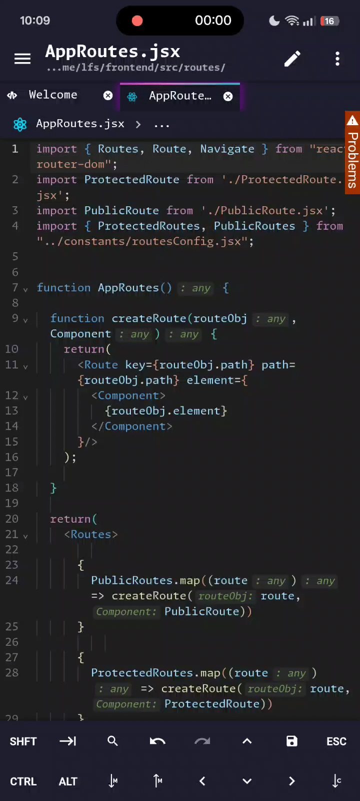
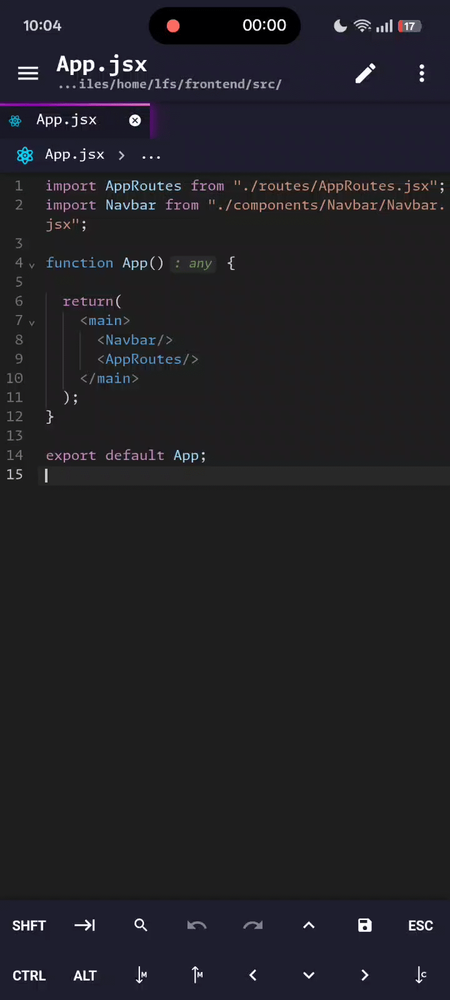
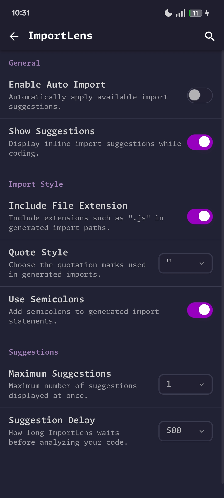

## ImportLens

Workspace-aware automatic import suggestions and module resolution for Acode.
ImportLens is a premium Acode plugin designed to make development faster and more convenient across JavaScript, TypeScript, and Python projects.

It scans your project workspace, indexes available exports, and detects unresolved identifiers in your code. When a matching export is found, ImportLens provides an interactive ghost-import preview directly inside the editor, allowing you to insert the suggested import with a tap.

### Why ImportLens?

Acode already supports Language Server Protocol (LSP) integration, which can provide code completion, diagnostics, and automatic import suggestions through compatible language servers.

ImportLens is designed to complement these capabilities by providing its own workspace-based import discovery and suggestion system.
It can be useful when LSP-based auto-import suggestions are unavailable, insufficient, or when you prefer ImportLens's interactive ghost-import workflow.

ImportLens does not replace LSP or its diagnostic capabilities. Both can be used alongside each other.

## Features

- Automatic import suggestions for unresolved identifiers.
- Interactive ghost-import previews directly inside the editor.
- Workspace scanning to discover available exports.
- Smart module resolution for local project files.
- Multiple import suggestions.
- Named and default import support.
- Named import merging from the same module.
- Duplicate import prevention.
- Configurable import formatting, including quote styles and semicolons.
- Customizable suggestion limits and analysis delay.
- JavaScript, TypeScript, and Python support.

## Screenshots

### Automatic Import

### Ghost Import Suggestions

### Settings

## Supported Languages

### JavaScript

- JavaScript (".js")
- React JavaScript (".jsx")

### TypeScript

- TypeScript (".ts")
- React TypeScript (".tsx")

### Python

- Python (".py")
- Python Stub (".pyi")
- Python Alternate (".pyw")

## Installation

1. Open Acode.
2. Navigate to the Plugin Store.
3. Search for ImportLens.
4. Purchase and install the plugin.

ImportLens is distributed as a premium plugin through the Acode Plugin Store.

## Requirements

- Acode editor.
- A supported JavaScript, TypeScript, or Python project.
- Project files accessible to the workspace scanner.

## Version

Current version: 1.1.1

See [CHANGELOG.md](https://github.com/Ryze282747/ImportLens-Showcase/blob/main/CHANGELOG.md) for release history.

## Developer

Created and maintained by Zylle Mojica.

## Contact

Have a suggestion, found a bug, or want to discuss the project?

- GitHub: [Ryze282747](https://github.com/Ryze282747)
- Instagram: [@ryzexlsv](https://www.instagram.com/ryzexlsv/)

## License

ImportLens is proprietary software.

Purchasing a license grants permission to use the plugin under the terms of the [Proprietary License](https://github.com/Ryze282747/ImportLens-Showcase/blob/main/LICENSE).

Redistribution, resale, and unauthorized sharing are prohibited.

Copyright © 2026 Zylle. All rights reserved.