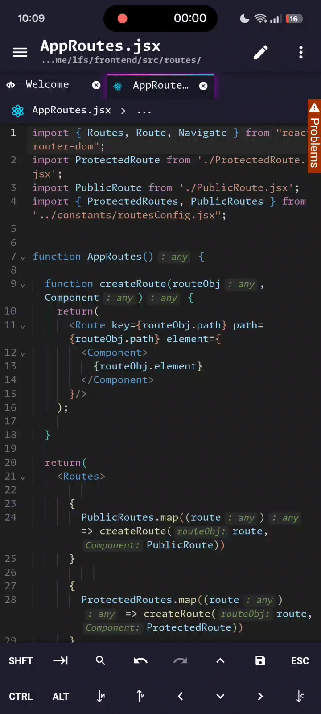
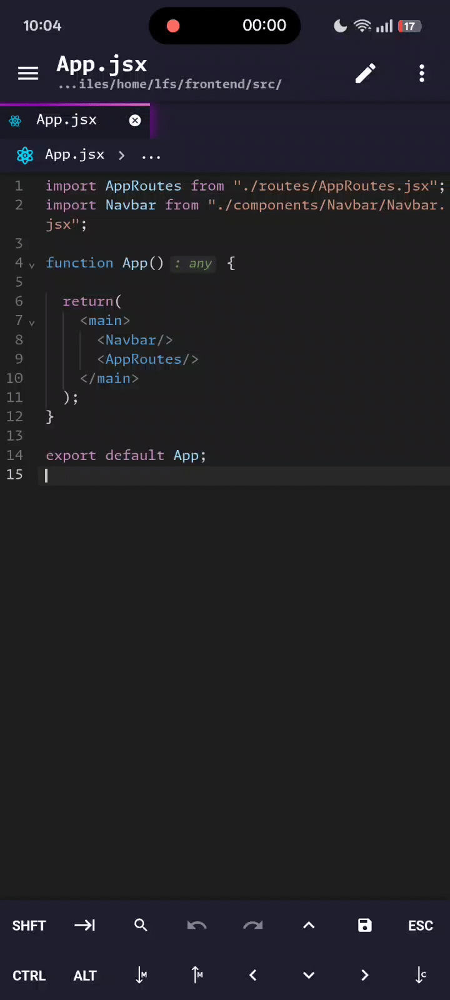
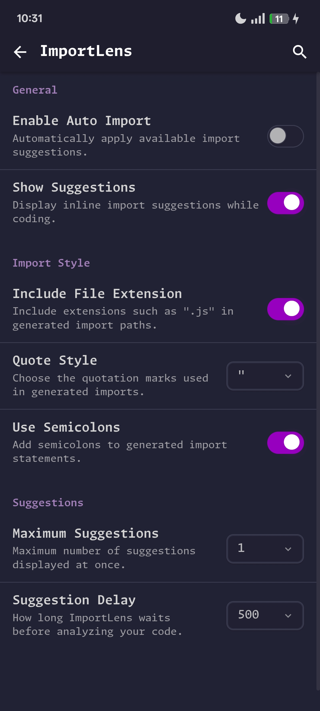

## ImportLens

Workspace-aware automatic import suggestions and module resolution for Acode.
ImportLens is a premium Acode plugin designed to make JavaScript and TypeScript development faster and more convenient.

It scans your project workspace, indexes available exports, and detects unresolved identifiers in your code. When a matching export is found, ImportLens provides an import suggestion directly inside the editor through an interactive ghost-import preview.

### Why ImportLens?

Acode already supports Language Server Protocol (LSP) integration, which can provide code completion, diagnostics, and automatic import suggestions through compatible language servers.

ImportLens is designed to complement these capabilities by providing its own workspace-based import discovery and suggestion system.
It can be useful when LSP-based auto-import suggestions are unavailable, insufficient, or when you prefer ImportLens's interactive ghost-import workflow.

ImportLens does not replace LSP or its diagnostic capabilities. Both can be used alongside each other.

## Features

- Automatic import insertion.
- Ghost import suggestions.
- Workspace scanning.
- Smart module resolution.
- Multiple import suggestions.
- Named import merging.
- Duplicate import prevention.
- Customizable settings.
- JavaScript and TypeScript support.

## Screenshots

### Automatic Import

### Ghost Import Suggestions

### Settings

## Supported Languages

- JavaScript (".js")
- React JavaScript (".jsx")
- TypeScript (".ts")
- React TypeScript (".tsx")

## Installation

1. Open Acode.
2. Navigate to the Plugin Store.
3. Search for ImportLens.
4. Purchase and install the plugin.

ImportLens is distributed as a premium plugin through the Acode Plugin Store.

## Requirements

- Acode editor.
- A JavaScript or TypeScript project.
- Project files accessible to the workspace scanner.

## Version

Current version: 1.0.0

See [CHANGELOG.md](https://github.com/Ryze282747/ImportLens-Showcase/blob/main/CHANGELOG.md) for release history.

## Developer

Created and maintained by Zylle Mojica.

## Contact

Have a suggestion, found a bug, or want to discuss the project?

- GitHub: [Ryze282747](https://github.com/Ryze282747)
- Instagram: [@ryzexlsv](https://www.instagram.com/ryzexlsv/)

## License

ImportLens is proprietary software.

Purchasing a license grants permission to use the plugin under the terms of the [Proprietary License](https://github.com/Ryze282747/ImportLens-Showcase/blob/main/LICENSE).

Redistribution, resale, and unauthorized sharing are prohibited.

Copyright © 2026 Zylle. All rights reserved.